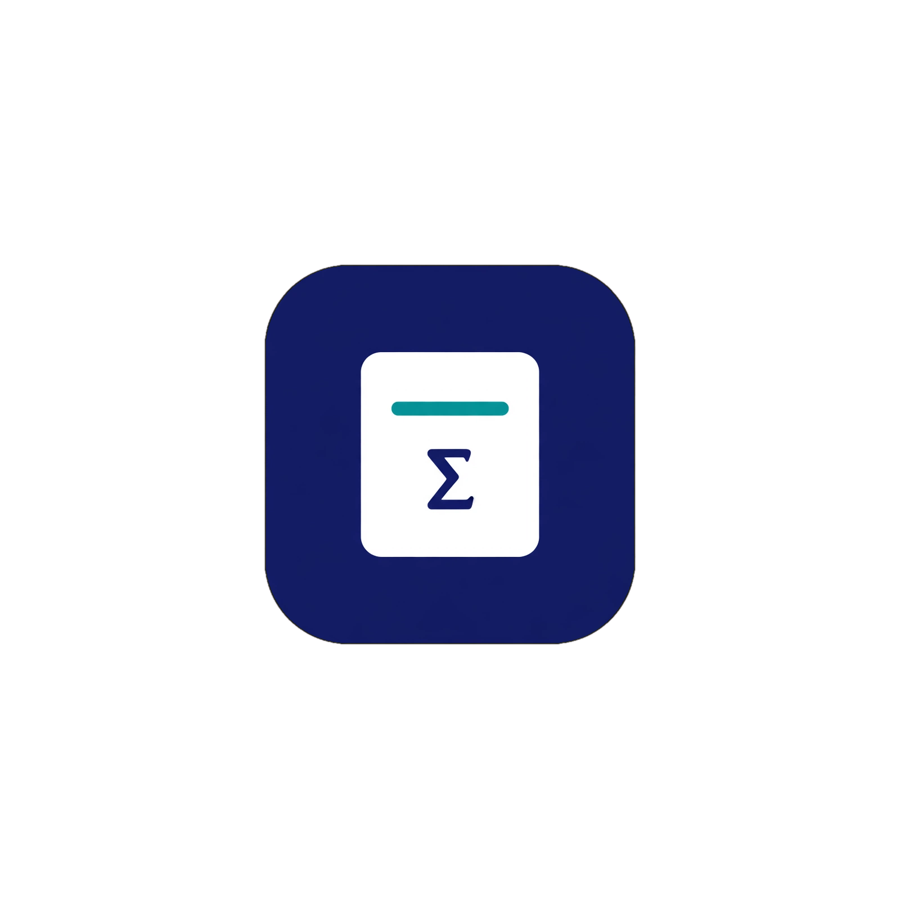
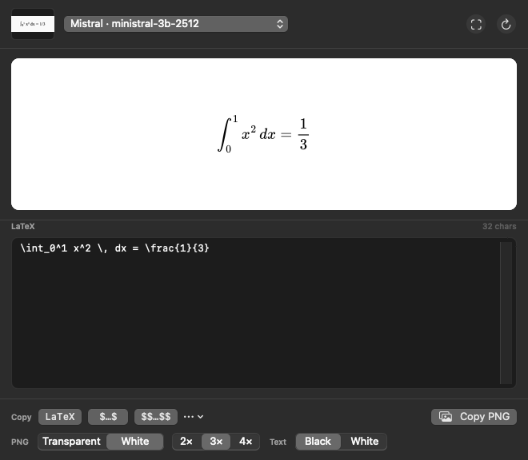
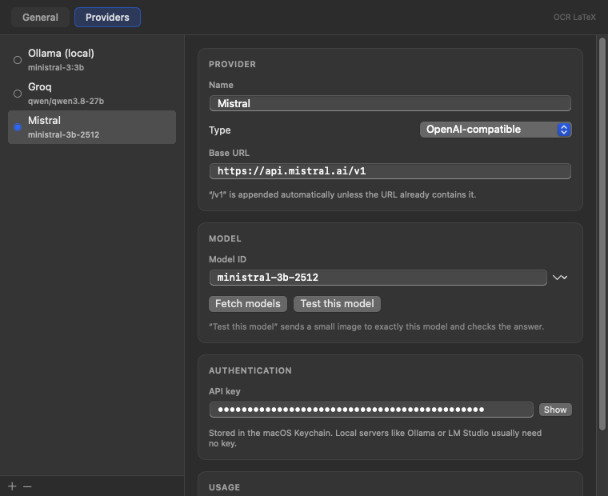

# OCR LaTeX

<p align="center">
  
</p>

<p align="center">
  
</p>

A macOS menu-bar app that turns a screenshot of a formula into LaTeX.
Press a shortcut, drag a box, and get a live-previewed formula you can copy as
LaTeX or as a high-resolution PNG.

Native Swift/SwiftUI (no Electron, no Python runtime). Works with any
OpenAI-compatible endpoint (OpenAI, OpenRouter, Groq, LM Studio, vLLM, DeepSeek…)
and with a local Ollama server.

- **`⌘⇧L` → drag a box → LaTeX.** Global shortcut (no Accessibility
  permission), native region selector, floating result window with a live
  MathJax preview.
- **Any vision model you like.** OpenAI-compatible endpoints and Ollama,
  switchable from the menu bar or the result window; per-model connection test.
- **Fallback when a provider fails.** A dead key, a text-only model or a
  stopped server costs a retry, not the capture.
- **Copy the way you need it.** Raw LaTeX, `$…$`, `$$…$$`, `\(…\)`, `\[…\]`,
  compact single-expression output, or a 2×/3×/4× PNG with transparent or white
  background and black or white glyphs.
- **Menu bar only.** No Dock icon, no window clutter. Keys live in the macOS
  Keychain; the only thing that leaves your Mac is the screenshot and your
  prompt, sent to the provider you selected.
- **Auto updates.** Checks GitHub Releases periodically (or on demand via
  *Check for Updates…*) and downloads/installs newer versions in place.

---

## Download or Build

### Download Release
Download the latest pre-built `.zip` from [Releases](https://github.com/namikemen/ocr-latex/releases).
Unzip `OCR-LaTeX-x.x.x-macOS.zip` and move `OCR LaTeX.app` to `/Applications`.

*Note for downloaded builds*: Because the app is ad-hoc signed, macOS Gatekeeper may show a warning on first launch. If prompted, run:
```bash
xattr -dr com.apple.quarantine "/Applications/OCR LaTeX.app"
```

### Build from source

Requires macOS 14+ and the Swift toolchain (Xcode or the Command Line Tools).

```bash
./build_app.sh                    # release build -> dist/OCR LaTeX.app
./build_app.sh release universal  # universal binary (Apple Silicon + Intel)
./build_app.sh debug              # debug build
./build_app.sh release run        # build and launch
```

The script compiles with SwiftPM, assembles the `.app` bundle, copies the
MathJax renderer into `Contents/Resources`, and ad-hoc signs the bundle.

Move `dist/OCR LaTeX.app` to `/Applications` (or anywhere permanent) and open
it. It lives in the menu bar only (`LSUIElement`), with a
`text.viewfinder` icon.

---

## First run

1. macOS asks for **Screen Recording** permission the first time you capture.
   Allow it in *System Settings → Privacy & Security → Screen Recording*, then
   capture again. (Re-signing or moving the app resets this permission —
   macOS treats it as a new binary.)
2. The Settings window opens because no model is configured yet. Add a provider
   and pick a model.

### Provider examples

| Provider | Type | Base URL | Model |
| --- | --- | --- | --- |
| OpenAI | OpenAI-compatible | `https://api.openai.com/v1` | `gpt-4o-mini`, `gpt-4.1-mini` |
| OpenRouter | OpenAI-compatible | `https://openrouter.ai/api/v1` | any vision model |
| LM Studio | OpenAI-compatible | `http://localhost:1234` | loaded model |
| Ollama | Ollama | `http://localhost:11434` | `qwen2.5vl:7b`, `llava`, `minicpm-v` |

*OpenAI-compatible* endpoints get `/v1` appended automatically unless the URL
already contains it. API keys are stored in the macOS Keychain.

Use **Fetch models** to list what the server actually has. **Test this model**
sends a small generated image ("2 + 2 = ?") to the exact model ID in the field
and checks the answer, so it proves that this model answers *and* can see
images — a URL/key check is not enough, since many text-only models reject
image payloads. You can register as many providers as you like and switch the
active one from the menu bar, the result window, or Settings.

<p align="center">
  
</p>

The API-key field has a **Show/Hide** toggle so you can paste and verify a key;
it is written to the Keychain as you type (debounced), never to UserDefaults.

**Fallback.** With *Settings → General → Reliability → Fall back to other
providers* enabled (the default), a capture tries the selected provider first
and then every other configured provider in list order, stopping at the first
successful answer. A key that is out of credit, a model that rejects images or
a local server that is not running therefore costs a retry instead of the
whole capture. The result window shows `via <provider>` when a fallback was
used, and if everything fails the error banner lists each provider's error.
Turn the switch off if you do not want a screenshot to leave the selected
provider.

Recommended for OCR quality: `qwen2.5vl`, `gemini`-class vision models,
`gpt-4o`/`gpt-4.1` family. Small models like `llava:7b` work but make more
symbol mistakes.

---

## Using it

| Action | How |
| --- | --- |
| Capture a region | `⌘⇧L` (configurable in Settings → General), or menu bar → *Capture Region…* |
| Capture from clipboard | menu bar → *Capture from Clipboard* |
| Re-run with another model | model picker in the result window, then the ↻ button |
| Copy raw LaTeX | **LaTeX** button |
| Copy inline / display math | **$…$** / **$$…$$** buttons (also `\(…\)`, `\[…\]` in the ⋯ menu) |
| Copy rendered image | **Copy PNG** |
| Save image | ⋯ → *Save PNG…* |
| Close the window | `esc` |

The LaTeX is editable: fix a symbol and the preview re-renders before you copy.

### Compact output

Models love to answer with an alignment block. **Settings → General → LaTeX
output → Compact form** (on by default) rewrites

```latex
\begin{align*}
x_{1} &= x = x_{4}
\end{align*}
```

as `x_{1} = x = x_{4}` before it reaches the editor, the preview and the
clipboard: the align/gather wrapper is dropped, `&` markers are removed, and
row breaks become `, `. Nested environments keep their layout, so matrices and
`cases` are never mangled. Turn it off to keep the model's original block.

### PNG output

Rendered with MathJax into SVG, then rasterised with AppKit — so it stays crisp
at 2×/3×/4× with configurable padding, on a transparent or white background.
Switch these in the result window footer or in Settings → General.

**Formula text** can be black or white. White is for pasting into dark slides,
Keynote/PowerPoint dark themes, or dark-mode documents; combine it with the
transparent background (white text on a white background is invisible, and the
app warns you if you pick that combination). The preview switches to a dark
checkerboard so the white glyphs stay visible while editing.

---

## Architecture

```
Sources/OCRLaTeX/
├── OCRLaTeXApp.swift        menu bar scene, app delegate, demo/self-test entry
├── Models/
│   ├── Models.swift         provider, settings, hotkey + copy-format models
│   └── AppModel.swift       single source of truth, persistence, capture flow
├── Services/
│   ├── HotkeyManager.swift  Carbon global hotkey (no Accessibility permission)
│   ├── ScreenCapture.swift  native interactive region capture
│   ├── LLMService.swift     OpenAI-compatible + Ollama vision clients
│   ├── MathRenderer.swift   offscreen WKWebView + MathJax → SVG → NSBitmapImageRep
│   ├── Clipboard.swift      text/PNG pasteboard + LaTeX post-processing
│   ├── Keychain.swift       API key storage
│   └── SelfTest.swift       headless verification modes
├── Views/                   menu, floating panel, result window, settings
└── Resources/               template.html + bundled MathJax (tex-svg)
```

### Verification modes

```bash
# Render check: writes four PNGs (transparent + white) and prints the endpoints
"dist/OCR LaTeX.app/Contents/MacOS/OCRLaTeX" --selftest /tmp/formula.png

# HTTP check: against the mock server in scripts/mockserver.py
python3 scripts/mockserver.py &
"dist/OCR LaTeX.app/Contents/MacOS/OCRLaTeX" --llmtest
# -> LLM PLUMBING OK

# UI check: opens the panel with sample content and writes a PNG
"dist/OCR LaTeX.app/Contents/MacOS/OCRLaTeX" --demo --ui-snapshot /tmp/panel.png
"dist/OCR LaTeX.app/Contents/MacOS/OCRLaTeX" --settings-snapshot /tmp/settings.png
```

---

## Notes

* The app is ad-hoc signed (`codesign -s -`). macOS may re-prompt for screen
  recording after a rebuild; that is expected without a Developer ID.
* Screen capture uses `/usr/sbin/screencapture -i`, so it inherits the
  standard macOS region selector (⇧-drag to resize, ⎋ to cancel).
* Requests are stateless — nothing is uploaded except the screenshot and your
  prompt, and only to the provider you selected.
